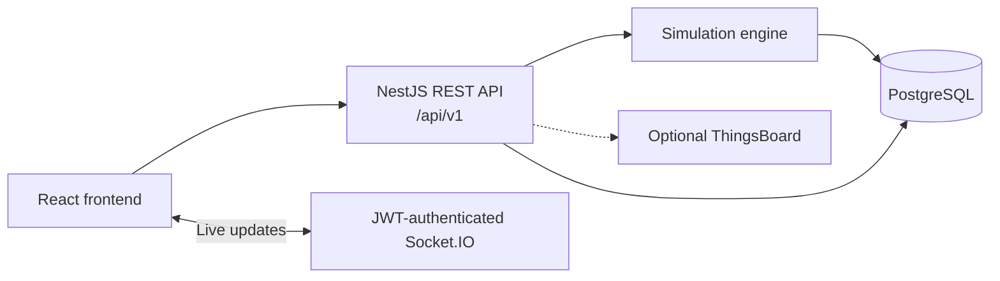

# CoolSense

**Smart AC Monitoring, Control, and Software Simulation Platform**

CoolSense is a full-stack HVAC application for managing virtual AC devices,
running room simulations, monitoring telemetry, and viewing energy analytics.
It is **100% software-only**; no physical hardware is required.

## Table of Contents

- [Overview](#overview)
- [Features and Status](#features-and-status)
- [Technology Stack](#technology-stack)
- [Architecture](#architecture)
- [Directory Structure](#directory-structure)
- [Setup](#setup)
- [Environment Variables](#environment-variables)
- [API Endpoints](#api-endpoints)
- [WebSocket Events](#websocket-events)
- [Simulation Logic](#simulation-logic)
- [Testing](#testing)
- [Docker Deployment](#docker-deployment)
- [Troubleshooting](#troubleshooting)
- [Future Improvements](#future-improvements)

## Overview

The project provides:

- JWT-based user accounts
- Virtual AC device configuration and control
- Software simulation of room temperature and humidity
- Live state updates with Socket.IO
- Telemetry storage and historical analytics
- Optional ThingsBoard synchronization
- PostgreSQL persistence with automatic retention

## Features and Status

| Status | Features |
| --- | --- |
| Implemented | Registration/login, devices, AC controls, thermostat simulation, telemetry, analytics, activity history, REST APIs, Socket.IO, and Docker startup |
| Partial | ThingsBoard synchronization; requires an external ThingsBoard installation and tenant-administrator credentials |
| Partial | In-browser mock mode using `VITE_USE_MOCK=true`; separate from the normal backend transport |
| Partial | NestJS Observe instrumentation; requires Observe app credentials |
| Proposed | CI/CD, refresh-token rotation, real production hardware protocols, and Swagger publication |

## Technology Stack

- **Frontend:** React 19, TypeScript, Vite, Tailwind CSS, React Router,
  TanStack Query, Axios, Recharts, Socket.IO Client
- **Backend:** NestJS 12, TypeScript, Passport/JWT, Socket.IO
- **Database:** PostgreSQL 16 and Prisma 7
- **Testing:** Vitest, Supertest, Oxlint
- **Infrastructure:** Docker, Docker Compose, Node.js 22
- **Optional integration:** ThingsBoard REST API

## Architecture



## Directory Structure

```text
coolsense/
├── backend/
│   ├── prisma/              # Schema and migrations
│   ├── src/
│   │   ├── ac-control/      # AC commands
│   │   ├── activity/        # Activity feed
│   │   ├── analytics/       # Energy and temperature analytics
│   │   ├── auth/            # Registration, login, JWT
│   │   ├── devices/         # Device CRUD
│   │   ├── simulation/      # Engine, scheduler, lifecycle
│   │   ├── telemetry/       # Telemetry and retention
│   │   ├── thingsboard/     # Optional external integration
│   │   └── users/
│   └── test/
├── frontend/
│   └── src/
│       ├── api/
│       ├── components/
│       ├── contexts/
│       ├── pages/
│       ├── services/
│       └── types/
├── docker-compose.yml
├── .env.example
├── run.sh
├── stop.sh
└── thingsboard.override.yml
```

## Setup

### Prerequisites

- Ubuntu/Linux with Bash
- Docker Engine and Docker Compose
- Node.js 22 and npm for local development

### Docker quick start

```bash
cp .env.example .env
# Set a private JWT_SECRET in .env
./run.sh
```

Open:

- Frontend: `http://localhost:5173`
- API: `http://localhost:3000/api/v1`
- Health: `http://localhost:3000/api/v1/health`
- PostgreSQL: `localhost:5434`

Stop without deleting database data:

```bash
./stop.sh
```

### Local development

```bash
cp .env.example .env
docker compose up -d database

cd backend
npm ci
npm run db:deploy
npm run start:dev
```

In another terminal:

```bash
cd frontend
npm ci
npm run dev
```

The backend runs on port `3000`; the Vite frontend runs on port `5173`.

### Prisma migrations

```bash
cd backend
npm run db:deploy                 # Apply migrations
npm run db:migrate                # Create a development migration
npm run db:generate               # Regenerate Prisma client
```


## Testing

Backend:

```bash
cd backend
npm test
npm run test:e2e
npm run test:cov
npm run lint
npm run build
```

Frontend:

```bash
cd frontend
npm run lint
npm run build
npm run preview
```

The frontend package does not define a `test` script or contain a frontend test
suite.

## Docker Deployment

The existing Compose stack and `./run.sh` are for development:

```bash
cp .env.example .env
./run.sh
```

The development database uses the existing `coolsense_postgres_data` Compose
volume key (named `coolsense_coolsense_postgres_data` with the default project
name).
Production uses a separate Compose file, isolated volume, compiled NestJS
build, and Nginx-served Vite build.

Useful commands:

```bash
docker compose ps
docker compose logs backend
docker compose exec database pg_isready
docker compose exec backend npm run db:deploy
```

Do not run `docker compose down -v` unless intentionally deleting PostgreSQL
data.

For ThingsBoard, set `THINGSBOARD_ENABLED=true` and provide tenant credentials.
The development launcher does not start a ThingsBoard service; configure its
endpoint in `.env` and manage that external service separately.

### Single-EC2 production deployment

The production Compose stack publishes only Nginx (port 80 by default).
PostgreSQL and the backend stay on the private Compose network. Production
containers have no source bind mounts, and the backend applies existing Prisma
migrations with `prisma migrate deploy` before starting the compiled app.

1. Copy the production template to a separate, ignored secrets file:

   ```bash
   cp .env.production.example .env.production
   chmod 600 .env.production
   ```

2. Generate two independent values with `openssl rand -hex 32`. Put one in
   `JWT_SECRET`. Put the other in `POSTGRES_PASSWORD` and use the same value in
   `DATABASE_URL` (the hex format is URL-safe). Replace
   `YOUR_EC2_PUBLIC_IP_OR_DOMAIN` in `FRONTEND_URL`. Do not commit
   `.env.production`.

3. Validate, build, and start the production stack:

   ```bash
   docker compose --env-file .env.production -f docker-compose.prod.yml config
   docker compose --env-file .env.production -f docker-compose.prod.yml build
   docker compose --env-file .env.production -f docker-compose.prod.yml up -d
   ```

4. Check service health and the public frontend/API:

   ```bash
   docker compose --env-file .env.production -f docker-compose.prod.yml ps
   curl -fsS http://localhost/healthz
   curl -fsS http://localhost/api/v1/health
   docker compose --env-file .env.production -f docker-compose.prod.yml \
     exec database pg_isready
   docker compose --env-file .env.production -f docker-compose.prod.yml \
     exec backend ./node_modules/.bin/prisma migrate status
   ```

   Register/log in through `/api/v1/auth/register` and
   `/api/v1/auth/login`; the frontend uses same-origin `/api/v1` and
   `/socket.io` paths. Use the AC controls and simulation UI to verify live
   telemetry. The frontend socket transport requires the `/socket.io/` Nginx
   proxy and a valid JWT.

The production database is stored in the separate
`coolsense-prod_postgres_prod_data` volume. Container restarts and `docker compose
down` preserve it; never use `down -v` unless you intend to delete the database.
ThingsBoard is disabled for the initial deployment. The Compose service applies
Prisma migrations at startup; never use `prisma migrate dev` in production.

Use an HTTPS-terminating load balancer or reverse proxy before handling real
credentials over the public internet. Restrict EC2 security-group ingress to
the frontend (and SSH from trusted addresses); do not open PostgreSQL or the
backend port. Check `docker stats` under representative simulations on the
target 4 GB instance before relying on the configured container memory limits.

## Troubleshooting

- **Missing `.env`:** copy `.env.example` and set `JWT_SECRET`.
- **Port conflict:** change `BACKEND_PORT` or `FRONTEND_PORT`, and update
  `FRONTEND_URL` for a new frontend origin.
- **Socket.IO rejected:** confirm the JWT is supplied and the frontend origin
  is allowed.
- **PostgreSQL unavailable:** run `docker compose ps`, inspect
  `docker compose logs database`, and check `pg_isready`.
- **Migration failure:** run `docker compose exec backend npm run db:deploy`
  and inspect backend logs.
- **ThingsBoard failure:** verify the enabled flag, credentials, URL
  reachability, and tenant permissions.

## Future Improvements

Proposed, not implemented:

- Frontend unit and end-to-end testing
- CI/CD workflows
- Swagger/OpenAPI documentation
- Refresh-token rotation
- Role-based authorization
- Real COP-based HVAC efficiency
- Configurable currency and units
- Production alerting and observability dashboards
- Production secret management and TLS
- Expanded ThingsBoard MQTT and bidirectional commands
